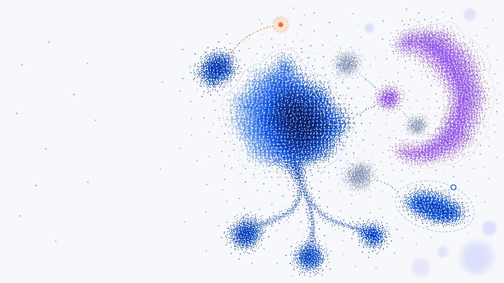
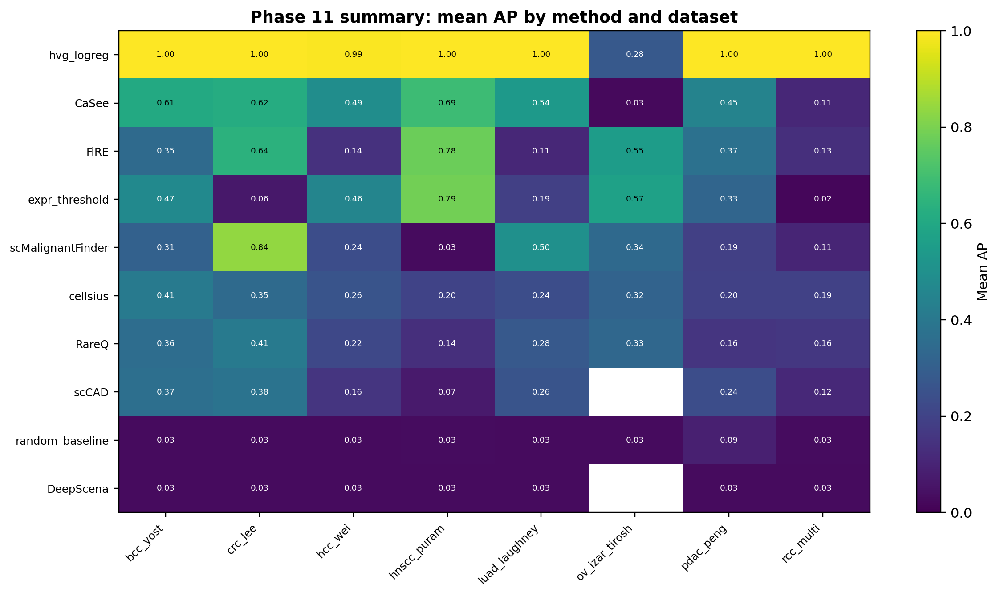
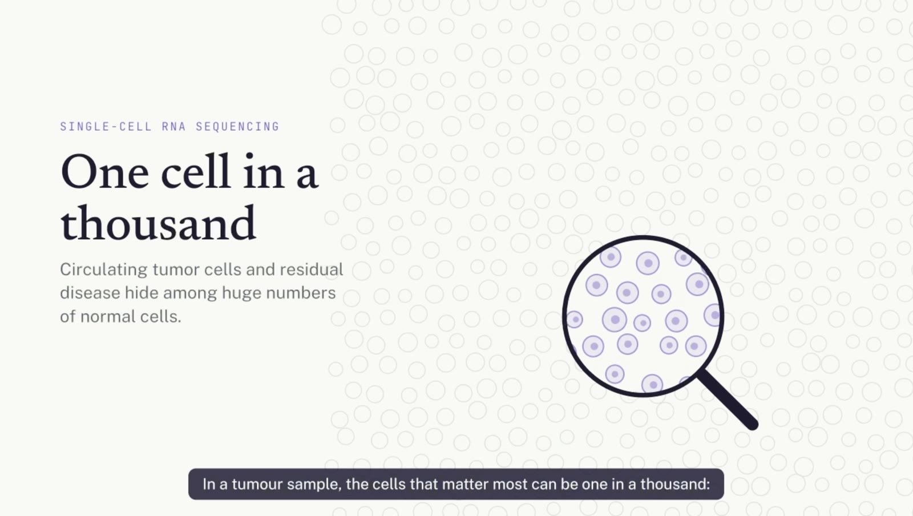
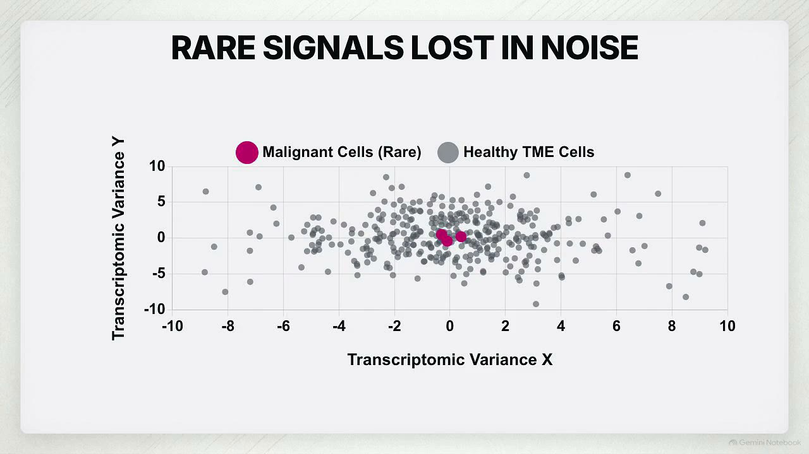

<div align="center">


# REACH Benchmark

**Rare-cell Evaluation Across Cancer Heterogeneity**<br>
A reproducible benchmark for detecting rare malignant cells in single-cell RNA sequencing

[](https://doi.org/10.3389/fbinf.2026.1878538)
[](https://doi.org/10.5281/zenodo.19847108)
[](https://jaswanthmoram.github.io/reach-rarecell-benchmark/)
[](https://github.com/jaswanthmoram/reach-rarecell-benchmark/actions/workflows/ci.yml)
[](https://www.python.org/downloads/)
[](LICENSE)

**[Website](https://jaswanthmoram.github.io/reach-rarecell-benchmark/)** · **[Article](https://www.frontiersin.org/journals/bioinformatics/articles/10.3389/fbinf.2026.1878538/full)** · **[PDF](https://jaswanthmoram.github.io/reach-rarecell-benchmark/manuscript/reach-fbinf-2026-1878538.pdf)** · **[Zenodo](https://doi.org/10.5281/zenodo.19847108)** · **[Reproduce](#reproduce-locally)** · **[Cite](#cite)** · **[Videos](#videos)**



</div>

REACH asks a narrow question: given a tumour or blood sample profiled by scRNA-seq, how well do published methods rank the few malignant cells above the many non-malignant ones? It assembles 10 public cancer cohorts (359,739 cells), labels malignant and background cells with a four-arm evidence rule (source annotation, inferred CNV, marker signature and kNN consistency), builds 1,125 benchmark units across six tracks, and runs 10 method wrappers on every unit, giving 11,250 method-unit evaluations scored by average precision. Code, configs, frozen result snapshots and the paper's tables and figures are in this repository; the large data archives are on Zenodo.

**Contents:** [At a glance](#at-a-glance) · [Article](#article) · [Website](#live-website) · [Layout](#repository-layout) · [Reproduce](#reproduce-locally) · [Data](#data-archives) · [Methods](#methods) · [Cite](#cite) · [Videos](#videos) · [Licence](#licence)

## At a glance

| | |
|---|---|
| Cohorts | 10 scRNA-seq cohorts: 8 solid tumours, 2 blood malignancies |
| Cells | 359,739 |
| Tracks | 6 (A real spike-ins, B synthetic stress, C null controls, D natural prevalence, E supervised label-noise diagnostic, F intra-lineage) |
| Methods | 10 wrappers: 6 ranked published detectors, 2 naive baselines, 1 supervised ceiling, 1 exploratory |
| Benchmark units | 1,125 |
| Method-unit evaluations | 11,250 |
| Primary metric | Average precision (AP, area under the precision-recall curve), P_HC vs B_HC |

**Headline results (Track A, 160 units).** Among the six ranked published detectors, FiRE has the highest median AP (0.313). It is not significantly different from the naive `expr_threshold` baseline (median AP 0.317; Wilcoxon p = 0.836, BH-FDR = 0.836). The supervised `hvg_logreg` reference reaches a median AP of 1.000; it uses the labels, so it is reported as a ceiling and is not ranked. Full tables: [`data/results/tables/phase11/leaderboard.csv`](data/results/tables/phase11/leaderboard.csv) and the [Leaderboard](https://jaswanthmoram.github.io/reach-rarecell-benchmark/leaderboard/) page.



## Article

> Satya Jaswanth MV, Gavin A, Aakash P, Tejesh Kumar M and Dasgupta A (2026) REACH: a reproducible benchmark for inter-lineage rare malignant cell detection in single-cell RNA sequencing. *Front. Bioinform.* 6:1878538. doi: [10.3389/fbinf.2026.1878538](https://doi.org/10.3389/fbinf.2026.1878538)

Published in *Frontiers in Bioinformatics* on 19 October 2026 (open access, CC BY).

* Article: [frontiersin.org](https://www.frontiersin.org/journals/bioinformatics/articles/10.3389/fbinf.2026.1878538/full)
* PDF: [reach-fbinf-2026-1878538.pdf](https://jaswanthmoram.github.io/reach-rarecell-benchmark/manuscript/reach-fbinf-2026-1878538.pdf)
* DOI: [10.3389/fbinf.2026.1878538](https://doi.org/10.3389/fbinf.2026.1878538)
* Code and data on Zenodo: concept DOI [10.5281/zenodo.19847108](https://doi.org/10.5281/zenodo.19847108) (always resolves to the latest release; see [Data archives](#data-archives) for the data records)

## Live website

**[jaswanthmoram.github.io/reach-rarecell-benchmark](https://jaswanthmoram.github.io/reach-rarecell-benchmark/)**

| Page | What it offers |
|---|---|
| [Overview](https://jaswanthmoram.github.io/reach-rarecell-benchmark/) | The benchmark in one page: design, headline numbers and the "REACH in 78 seconds" film |
| [Leaderboard](https://jaswanthmoram.github.io/reach-rarecell-benchmark/leaderboard/) | Ranks of the 10 methods across 1,125 units, global and pairwise significance tests, per-cohort results |
| [Tracks](https://jaswanthmoram.github.io/reach-rarecell-benchmark/tracks/) | The six evaluation tracks, A to F: what each one tests and how its units are built |
| [Datasets](https://jaswanthmoram.github.io/reach-rarecell-benchmark/datasets/) | The 10 cohorts: accessions, cell counts, the malignant labelling rule and the CNV check |
| [Methods](https://jaswanthmoram.github.io/reach-rarecell-benchmark/methods/) | The 10 methods: inputs, how each scores cells, run cost and when to use it |
| [Reproduce](https://jaswanthmoram.github.io/reach-rarecell-benchmark/reproduce/) | Install the package, run a method on a toy unit and rebuild the paper tables and figures |
| [Figures](https://jaswanthmoram.github.io/reach-rarecell-benchmark/figures/) | The article figures with captions and full-size views |
| [Cite](https://jaswanthmoram.github.io/reach-rarecell-benchmark/cite/) | How to cite the article, code, data and predictions, with DOIs, BibTeX and licences |
| [Use cases](https://jaswanthmoram.github.io/reach-rarecell-benchmark/use-cases/) | Five reader routes through REACH and the edge cases that change the answer |

Older `/#/` links (for example `/#/leaderboard`) redirect to the clean URLs above. The github.io address forwards to the account's custom domain, so the site is also served at [jaswanthmoram.me/reach-rarecell-benchmark](https://jaswanthmoram.me/reach-rarecell-benchmark/).

## Repository layout

```text
reach-rarecell-benchmark/
├── src/rarecellbenchmark/   Python package and the `rcb` CLI (ingest, preprocess, validate, tracks, methods, evaluate, figures)
├── scripts/                 Pipeline entry points: snapshot reproduction, Phase 11 statistics, method runs, Zenodo download
├── configs/                 YAML configs for datasets, methods, metrics, signatures and tracks
├── data/results/snapshots/  Frozen per-unit, per-method and per-dataset CSVs behind the paper (paper_v1/)
├── data/results/            Phase 11 tables, Phase 12 figures and Track F / revision results
├── docs/                    Architecture, methods, metrics, fairness, reproducibility and extension guides
├── tests/                   Unit, workflow and smoke tests (pytest)
├── setup/                   R package installer and external-method setup
└── website/                 React + Vite source of the live website
```

The website lives in `website/` and is deployed to GitHub Pages by [`.github/workflows/deploy-website.yml`](.github/workflows/deploy-website.yml) on every push to `main` that touches `website/`, a common pattern for paper repositories. To run it locally (Node 22, as in the workflow):

```bash
cd website
npm ci
npm run dev       # development server at http://localhost:5173 (or the port Vite prints)
npm run build     # type-check, production build and route prerender into website/dist/
npm run preview   # serve the production build locally
```

Pages use clean URLs (`/reach-rarecell-benchmark/<page>/`), and any section can be linked with `#<section-id>`. `npm run build` writes one `index.html` per page plus `404.html`, `sitemap.xml` and `robots.txt`, so deep links and refreshes work on GitHub Pages. A new page must be added to `ROUTES` in `website/src/lib/router.ts`; the build reads that list.

## Reproduce locally

Full detail: [`docs/reproducibility.md`](docs/reproducibility.md) and the [reproducibility receipt](docs/reproducibility_receipt.md).

### Requirements

* Python 3.11 or newer (CI tests 3.11 and 3.12).
* Optional, for the R-based methods (FiRE, CellSIUS, RareQ): R 4.5 with FiRE, Seurat, CellSIUS and RareQ, installed by `Rscript setup/install_r_packages.R` (see also `setup/setup_external_methods.sh`).
* Optional, for DeepScena: PyTorch (`pip install -e '.[gpu]'`) and preferably a GPU.
* Nothing else is needed for the quick checks and the snapshot reproduction below: no R, no GPU and no downloads beyond PyPI.

### Install

```bash
git clone https://github.com/jaswanthmoram/reach-rarecell-benchmark.git
cd reach-rarecell-benchmark
python3 -m venv .venv
source .venv/bin/activate          # Windows: .venv\Scripts\activate
python -m pip install -e '.[dev,cnv]'
```

The `cnv` extra adds `infercnvpy`, which one test needs; `.[dev]` alone is enough for everything else. A fresh install takes one to two minutes.

### Quick checks

| Command | Expected result | Time* |
|---|---|---|
| `rcb --help` | Lists the CLI commands | ~1 s |
| `rcb smoke-test` | `RESULTS: 4 passed, 0 failed, 0 skipped` and `All smoke tests passed` | 10 to 30 s |
| `pytest -q` | 53 passed, 4 skipped (FiRE, RareQ and CellSIUS skip without their R packages, DeepScena without PyTorch) | ~40 s |
| `python scripts/run_all.py --toy` | Creates toy data in `data/toy/` and reruns the smoke test | ~25 s |

\*Measured on a fresh clone in a new Python 3.12 virtual environment on an Apple Silicon Mac, October 2026.

### Regenerate the paper tables and figures from frozen snapshots

```bash
python scripts/phase11_statistics.py --from-snapshots   # Phase 11 tables -> data/results/tables/phase11/ (~8 s)
python scripts/reproduce_from_snapshots.py              # tables + Phase 12 figures -> data/results/figures/phase12/ (~15 s)
# or both in one step:
python scripts/run_all.py --from-snapshots
```

These read only the CSVs in `data/results/snapshots/paper_v1/`. On a clean clone the regenerated `leaderboard.csv` is byte-identical to the committed one; a few other tables differ only in the last floating-point digit. Workflow structure can be checked without running anything:

```bash
snakemake -n --cores 1   # dry run of the public snapshot workflow
snakemake --cores 1      # real run: Phase 11 tables + Phase 12 figures (Fig0 to Fig11) from the snapshots
dvc repro --dry          # lists the public_phase11, public_phase12, toy_smoke and full_data_phase11 stages
```

### Run a method on a toy unit

```bash
rcb create-toy-data
rcb run-method --method expr_threshold --unit-id toy_test --input data/toy/toy_expression.h5ad
head -5 data/predictions/expr_threshold/toy_test_predictions.csv
```

### Full pipeline

The full benchmark (all 11,250 predictions) needs the Zenodo archives, about 20 GB in total.

1. Install the R packages (above) and, for DeepScena, PyTorch.
2. Download and unpack the archives into the repository: `python scripts/download_zenodo_data.py` (uses `aria2c`, which must be on your `PATH`).
3. Run the phases, as described step by step in [`docs/benchmark_regeneration.md`](docs/benchmark_regeneration.md):

```bash
python scripts/run_phase.py --phase 2 --dataset <DATASET>      # preprocessing
python scripts/run_phase.py --phase 3 --dataset <DATASET>      # validation and tier assignment
rcb run-track --track a --dataset <DATASET> --processed-h5ad data/processed/<DATASET>.h5ad
python scripts/run_methods.py --methods all --units-dir data/tracks --output-dir data/predictions --continue-on-error
python scripts/run_phase.py --phase 11                          # evaluation and statistics
python scripts/run_phase.py --phase 12                          # figures
```

If you only want to re-score the published predictions, restore the predictions and track-unit archives and run phases 11 and 12 alone.

**Compute.** The full rerun takes roughly 3 to 7 days on a 32-core, 128 GB workstation; method execution dominates (48 to 96 h). The revision runs used a 16-vCPU AMD EPYC 7B12 node with 62 GiB RAM and no GPU.

**DeepScena and GPUs.** DeepScena is the only method that benefits from a GPU. Its Track F predictions were produced on a Google Colab T4; see [`docs/deepscena_colab_instructions.md`](docs/deepscena_colab_instructions.md).

**Docker.** The `Dockerfile` builds a Python-only image and `Dockerfile.r` adds R and the R-based methods; Docker Compose wraps both:

```bash
docker build -t reach-rarecell-benchmark .
docker run --rm reach-rarecell-benchmark rcb smoke-test
docker compose up                                  # Python image, runs the smoke test
docker compose --profile r-methods up              # adds the R image
```

Release builds are also pushed to `ghcr.io/jaswanthmoram/reach-rarecell-benchmark`.

### Platform notes

* On Apple Silicon, Snakemake's default ILP scheduler can fail with `Bad CPU type in executable` (an x86 `cbc` solver bundled with PuLP); add `--scheduler greedy`.
* `tests/validate/test_cnv_real.py` exercises the real infercnvpy path and is skipped unless the `cnv` extra is installed (`pip install -e '.[dev,cnv]'`).

## Data archives

Raw data come from GEO (accessions below). Processed data, benchmark units and predictions are on Zenodo:

| Archive | DOI | Size |
|---|---|---|
| Code, configs, frozen snapshots and Track F bundle (concept DOI) | [10.5281/zenodo.19847108](https://doi.org/10.5281/zenodo.19847108) | ~185 MB |
| Processed AnnData for all 10 cohorts | [10.5281/zenodo.19850652](https://doi.org/10.5281/zenodo.19850652) | 7.3 GB |
| Benchmark units, Tracks A to C (440 units) | [10.5281/zenodo.19850972](https://doi.org/10.5281/zenodo.19850972) | 9.7 GB |
| Benchmark units, Tracks D and E (670 units) | [10.5281/zenodo.19851287](https://doi.org/10.5281/zenodo.19851287) | 2.2 GB |
| Per-cell predictions and run metadata (10 methods x 1,125 units) | [10.5281/zenodo.19851710](https://doi.org/10.5281/zenodo.19851710) | 425 MB |

| Dataset | Cancer type | Cells | Platform | Accession |
|---|---|---|---|---|
| hnscc_puram | Head and neck SCC | 5,902 | SMART-seq2 | GSE103322 |
| ov_izar_tirosh | Ovarian cancer (ascites) | 9,482 | 10x Chromium | GSE146026 |
| hcc_wei | Hepatocellular carcinoma | 19,382 | 10x Chromium | GSE149614 |
| luad_laughney | Lung adenocarcinoma | 33,782 | 10x Chromium | GSE123902 |
| rcc_multi | Renal cell carcinoma | 33,574 | 10x Chromium | GSE159115 |
| pdac_peng | Pancreatic ductal adenocarcinoma | 123,488 | 10x Chromium | GSE202051 |
| crc_lee | Colorectal cancer | 55,551 | 10x Chromium | GSE132465 |
| bcc_yost | Basal cell carcinoma | ~47,000 | 10x Chromium | GSE123813 |
| mm_ledergor | Multiple myeloma | 31,181 | 10x Chromium | GSE161801 |
| breast_ctc_szczerba | Breast cancer CTCs | 357 | SMART-seq2 | GSE109761 |

## Methods

| Method | Role | Notes |
|---|---|---|
| FiRE | Ranked | R package |
| CellSIUS (`cellsius`) | Ranked | R package |
| RareQ | Ranked | R package |
| scCAD | Ranked | Anomaly-based scorer |
| scMalignantFinder | Ranked | Python scorer |
| DeepScena | Ranked | PyTorch; GPU recommended |
| CaSee | Exploratory | Faithful recreation (Yu et al., 2022) |
| `expr_threshold` | Naive baseline | Marker-expression score |
| `random_baseline` | Naive baseline | Random floor |
| `hvg_logreg` | Supervised ceiling | Uses labels; not ranked |

Track E is a label-noise diagnostic: it measures robustness only for `hvg_logreg`, the one method that consumes labels. Metric definitions are in [`docs/metrics.md`](docs/metrics.md), method details and the inclusion audit in [`docs/METHODS.md`](docs/METHODS.md), and the wrapper interface for adding a method in [`docs/adding_new_method.md`](docs/adding_new_method.md).

## Further reading

[Architecture](docs/architecture.md) · [Fairness and leakage controls](docs/fairness.md) · [Results interpretation](docs/results_interpretation.md) · [Datasets](docs/DATASETS.md) · [Installation](docs/installation.md) · [Troubleshooting](docs/troubleshooting.md) · [Manuscript source](paper.md)

## Cite

Please cite the article for any result, figure or design choice, and the Zenodo archive for the code or data you used (name the release you ran). Machine-readable software metadata is in [`CITATION.cff`](CITATION.cff).

```bibtex
@article{satyajaswanth2026reach,
  title   = {{REACH}: a reproducible benchmark for inter-lineage rare malignant cell detection in single-cell {RNA} sequencing},
  author  = {Satya Jaswanth, Moram Venkata and Gavin, Amruthaluri and Aakash, Padarthi and Tejesh Kumar, Muttha and Dasgupta, Abhijit},
  journal = {Frontiers in Bioinformatics},
  year    = {2026},
  volume  = {6},
  pages   = {1878538},
  doi     = {10.3389/fbinf.2026.1878538},
  url     = {https://doi.org/10.3389/fbinf.2026.1878538}
}

@software{moram2026reach_zenodo,
  author    = {Moram, Venkata Satya Jaswanth},
  title     = {{REACH} Benchmark: code, configs and frozen result snapshots},
  publisher = {Zenodo},
  year      = {2026},
  doi       = {10.5281/zenodo.19847108},
  url       = {https://doi.org/10.5281/zenodo.19847108}
}
```

The data archives have their own DOIs (see [Data archives](#data-archives)); please also cite the source study of each cohort you use.

## Videos

<!-- Maintainers: for inline playback on GitHub, open this README in the github.com editor and drag each MP4 (website/public/video/) into it; GitHub uploads it and inserts a user-attachments URL that plays in place. -->

<table>
  <tr>
    <td width="50%" valign="top">
      <a href="https://jaswanthmoram.github.io/reach-rarecell-benchmark/video/reach-overview.mp4"></a>
      <br><b>REACH in 78 seconds</b><br>A short overview film. Also on the website's Overview page.
    </td>
    <td width="50%" valign="top">
      <a href="https://jaswanthmoram.github.io/reach-rarecell-benchmark/video/reach-anatomy.mp4"></a>
      <br><b>Anatomy of a benchmark</b><br>Engineering REACH for scRNA-seq, phase by phase (about 8 minutes).
    </td>
  </tr>
</table>

## Revision history

The Frontiers in Bioinformatics revision answered all 15 reviewer points. It added Track F (intra-lineage, 15 units from crc_lee, all 10 methods), validated the infercnvpy CNV arm against published annotations (overall AUROC 0.782 across 9 datasets), added a CNV circularity check, effect sizes and threshold-sensitivity analyses, and filtered degenerate CaSee units. Details: [`CHANGELOG.md`](CHANGELOG.md), [`data/results/REVISION_RESULTS_INDEX.md`](data/results/REVISION_RESULTS_INDEX.md) and [`data/results/VERIFICATION_ISSUES.md`](data/results/VERIFICATION_ISSUES.md).

## Licence

Code is released under the [MIT License](LICENSE). The article is open access under CC BY. Public datasets keep the terms of their original GEO depositors.

## Contributing

Issues and pull requests are welcome; see [`CONTRIBUTING.md`](CONTRIBUTING.md), the [code of conduct](CODE_OF_CONDUCT.md) and the [security policy](SECURITY.md). New methods should follow [`docs/adding_new_method.md`](docs/adding_new_method.md) and pass `pytest -q` and `rcb smoke-test`.

## Contact

Corresponding author: **Abhijit Dasgupta**, Artificial Intelligence Technology Institute, SRM University-AP, Amaravati, Andhra Pradesh, India (abhijit.d@srmap.edu.in). For code questions, please [open an issue](https://github.com/jaswanthmoram/reach-rarecell-benchmark/issues).

## Acknowledgements

We thank the authors of the ten public cohorts and of the benchmarked methods for making their data and code available, the handling editor and the two reviewers whose comments shaped the revision, and the Department of Computer Science and Engineering and the Artificial Intelligence Technology Institute at SRM University-AP.
